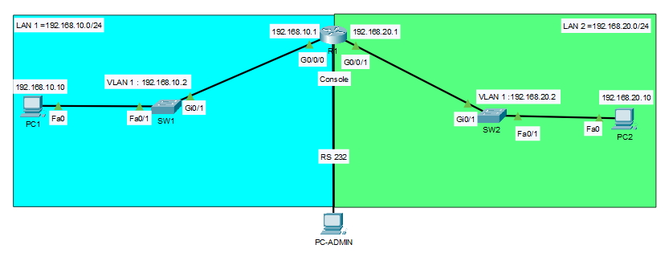
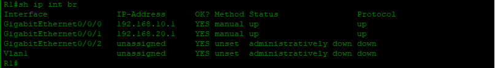

# Lab 01 — Configuration initiale et sécurisation de base de Cisco IOS

**Domaines CCNA 200-301 :** Network Fundamentals · Network Access
**Progression Jeremy's IT Lab :** Days 1 à 4 et Day 9
**Outil :** Cisco Packet Tracer 8.2 · **Statut :** réalisé

## Objectif

Mettre en service deux réseaux locaux reliés par un router, en configurant chaque équipement depuis la CLI : identité, accès sécurisés, interfaces, management IP address des switches et sauvegarde. Puis diagnostiquer et corriger une double panne injectée dans la maquette.

## Topologie

```
   PC1                                                   PC2
192.168.10.10                                      192.168.20.10
     |                                                    |
   Fa0/1                                                Fa0/1
   [SW1] --Gi0/1---- G0/0/0 [ R1 ] G0/0/1 ----Gi0/1-- [SW2]
 192.168.10.2      192.168.10.1   192.168.20.1       192.168.20.2
                          |
                       Console
                          |
                     [PC-ADMIN]

LAN 1 : 192.168.10.0/24          LAN 2 : 192.168.20.0/24
```



## Plan d'adressage

| Équipement | Interface | IP address | Subnet mask | Gateway |
|---|---|---|---|---|
| R1 | G0/0/0 | 192.168.10.1 | 255.255.255.0 | — |
| R1 | G0/0/1 | 192.168.20.1 | 255.255.255.0 | — |
| SW1 | VLAN 1 | 192.168.10.2 | 255.255.255.0 | 192.168.10.1 |
| SW2 | VLAN 1 | 192.168.20.2 | 255.255.255.0 | 192.168.20.1 |
| PC1 | Fa0 | 192.168.10.10 | 255.255.255.0 | 192.168.10.1 |
| PC2 | Fa0 | 192.168.20.10 | 255.255.255.0 | 192.168.20.1 |

## Configuration réalisée

Les configurations complètes sont dans [`configs/`](configs/), mots de passe expurgés.

**Sur les trois équipements**

| Objectif | Commande |
|---|---|
| Identifier l'équipement | `hostname R1` |
| Éviter la DNS resolution des fautes de frappe | `no ip domain-lookup` |
| Protéger le privileged EXEC mode par un hash | `enable secret <mdp>` |
| Chiffrer les mots de passe restés en clair | `service password-encryption` |
| Avertir légalement à la connexion | `banner motd ^C ... ^C` |
| Sécuriser la console | `line con 0` + `password`, `login`, `logging synchronous`, `exec-timeout 5 0` |
| Sauvegarder | `copy running-config startup-config` |

**Sur R1** — adresse, description et activation de chaque interface utilisée ; interface inutilisée laissée en `shutdown`.

```
interface GigabitEthernet0/0/0
 description ##To SW1##
 ip address 192.168.10.1 255.255.255.0
 no shutdown
```

**Sur SW1 et SW2** — management IP address sur l'interface VLAN 1, default gateway, et désactivation de tous les ports inutilisés :

```
interface range FastEthernet0/2-24
 shutdown
```

## Tests de validation

| # | Test | Commande | Résultat attendu | Résultat |
|---|---|---|---|---|
| T1 | Interfaces de R1 actives | `show ip interface brief` | G0/0/0 et G0/0/1 en `up/up` | OK |
| T2 | Aucun mot de passe en clair | `show running-config` | Tous les mots de passe en type 5 ou type 7 | OK |
| T3 | Ports inutilisés fermés | `show interfaces status` | Fa0/2 à Fa0/24 en `disabled` | OK |
| T4 | Communication inter-LAN | `ping 192.168.20.10` depuis PC1 | 4/5 packets (le premier échoue : ARP resolution) | OK |
| T5 | Gestion à distance des switches | `ping 192.168.20.2` depuis PC1 | Réussi | OK |
| T6 | Speed et duplex forcés sur SW2 Fa0/1 (vers PC2) | `show running-config` | `duplex full` et `speed 100` présents sur l'interface | OK (voir note de méthode) |



## Diagnostic de panne

**Symptôme :** PC1 ne joint plus PC2. Deux anomalies ont été injectées dans la maquette, à identifier depuis PC1 et R1 uniquement.

| # | Hypothèse testée | Commande | Résultat | Conclusion |
|---|---|---|---|---|
| 1 | Configuration IP de PC1 | `ipconfig` | Adresse, masque et gateway conformes au plan | PC1 hors de cause |
| 2 | Connectivité locale vers la gateway | `ping 192.168.10.1` | Réponse positive | Le LAN 1 et R1 fonctionnent |
| 3 | Connectivité inter-LAN | `ping 192.168.20.10` | Échec | Le problème est au-delà de R1 |
| 4 | État des interfaces de R1 | `show ip interface brief` | G0/0/0 en `up/up`, **G0/0/1 `administratively down`** | **Anomalie 1 trouvée** |
| 5 | Après `no shutdown` sur G0/0/1 | `ping 192.168.20.10` depuis PC1 | Échec persistant (4/4 perdus) | Une seconde anomalie subsiste |
| 6 | Test discriminant depuis R1 | `ping 192.168.20.10` depuis R1 | **5/5 réussis** | PC2 est vivant et joignable depuis son propre subnet |
| 7 | Présence des deux postes en couche 2 | `show ip arp` sur R1 | PC1 sur G0/0/0, PC2 sur G0/0/1 | Câblage et commutation hors de cause : le défaut est en couche 3 |

```
R1>ping 192.168.20.10
Sending 5, 100-byte ICMP Echos to 192.168.20.10, timeout is 2 seconds:
!!!!!
Success rate is 100 percent (5/5), round-trip min/avg/max = 0/0/1 ms

R1>show ip arp
Protocol  Address          Age (min)  Hardware Addr   Type   Interface
Internet  192.168.10.1            -   0060.3E94.A501  ARPA   GigabitEthernet0/0/0
Internet  192.168.10.10           1   0000.0C0B.7B54  ARPA   GigabitEthernet0/0/0
Internet  192.168.20.1            -   0060.3E94.A502  ARPA   GigabitEthernet0/0/1
Internet  192.168.20.10           1   0002.171E.4ABD  ARPA   GigabitEthernet0/0/1
```

**Raisonnement.** R1 partage le subnet 192.168.20.0/24 avec PC2 : il le joint sans gateway, et il réussit. PC1, lui, échoue. Puisque le forward path est prouvé fonctionnel et que les deux postes répondent en ARP, l'anomalie ne peut être que sur le chemin **retour** : PC2 reçoit l'écho mais ne sait pas acheminer sa réponse vers un subnet distant. La cause est donc sa default gateway.

**Anomalie 2 :** default gateway de PC2 fixée à 192.168.20.254 au lieu de 192.168.20.1. Un ping échoue alors que l'ensemble du réseau est sain.

**Corrections appliquées**

1. `interface GigabitEthernet0/0/1` puis `no shutdown` sur R1.
2. Gateway de PC2 remise à 192.168.20.1.
3. Vérification finale dans les deux sens : PC1 → PC2 et PC2 → PC1.

## Ce que j'ai appris

- Un ping qui réussit vers la gateway mais échoue vers le réseau distant déplace l'enquête au-delà du first hop : le défaut est soit sur le router, soit sur le return path.
- Une panne peut en cacher une autre. Après chaque correction, il faut refaire le test complet plutôt que supposer le problème résolu.
- Un défaut de return path est invisible depuis l'émetteur : seul un test depuis un équipement du subnet distant permet de le distinguer d'un défaut d'acheminement aller.
- Speed et duplex se configurent **des deux côtés à l'identique**. Forcer une seule extrémité désactive l'auto-negotiation de ce côté et provoque un désaccord : sur du matériel réel, le lien reste actif mais subit des late collisions et un débit effondré ; Packet Tracer coupe franchement le lien.
- `service password-encryption` ne protège que faiblement : c'est `enable secret`, qui stocke un hash, qui sécurise réellement le privileged EXEC mode.
- Désactiver les ports inutilisés est une mesure de sécurité de base, systématique en production.

## Questions de révision

<details>
<summary><b>1. Quelle différence entre <code>enable password</code> et <code>enable secret</code> ?</b></summary>

Les deux protègent le mode EXEC privilégié, mais pas avec la même robustesse.

`enable password` stocke historiquement le mot de passe en clair dans la configuration. Il peut être masqué par `service password-encryption`, qui applique un chiffrement réversible de type 7.

`enable secret` stocke un hash cryptographique : MD5 (type 5), SHA-256 (type 8) ou scrypt (type 9) selon la version d'IOS et les options utilisées.

`enable secret` est donc la méthode recommandée. Lorsque les deux sont configurés, `enable secret` est prioritaire.
</details>

<details>
<summary><b>2. Que protège réellement <code>service password-encryption</code> ?</b></summary>

Cette commande chiffre les mots de passe stockés en clair dans la configuration, notamment ceux définis par `enable password` et sur les lignes console et VTY.

Elle utilise un chiffrement réversible de type 7, facilement déchiffrable avec des outils disponibles publiquement. Sa seule utilité réelle est d'empêcher la lecture par-dessus l'épaule.

Elle ne remplace donc pas `enable secret`.
</details>

<details>
<summary><b>3. Quelle différence entre <code>running-config</code> et <code>startup-config</code> ?</b></summary>

La `running-config` est la configuration active, stockée en RAM. Elle est volatile : toute modification non sauvegardée est perdue au redémarrage.

La `startup-config` est stockée en NVRAM. C'est elle que l'équipement charge au démarrage.

Pour sauvegarder : `copy running-config startup-config`, ou son raccourci `wr`.
</details>

<details>
<summary><b>4. Pourquoi un switch de couche 2 a-t-il besoin d'une default gateway ?</b></summary>

Un switch de couche 2 commute les frames à partir des MAC addresses et de sa MAC address table : il n'a besoin d'aucune IP address pour cette fonction.

L'IP address configurée sur une interface VLAN (SVI) sert uniquement à son administration à distance (Telnet, SSH, SNMP). Elle ne le transforme pas en router.

La default gateway lui permet de répondre à un administrateur situé dans un autre subnet IP. Sans elle, il reçoit la requête mais ne sait pas acheminer la réponse.
</details>

## Notes de méthode

Deux limites de Packet Tracer 8.2 rencontrées pendant ce lab, à connaître pour ne pas tirer de fausses conclusions :

| Observation | Réalité |
|---|---|
| `show running-config interface <int>` est refusée | Variante non implémentée par le simulateur. Contournée par `show running-config` complet. |
| `show interfaces status` affiche `a-full` / `a-100` même avec `speed` et `duplex` forcés | Sur un IOS réel, le préfixe `a-` disparaît quand la valeur est codée en dur. Le simulateur ne reproduit pas ce détail : c'est `show running-config` qui fait foi. |

Règle que j'en retire : ne jamais conclure sur un seul affichage, toujours recouper avec une seconde commande.

## Fichiers

| Fichier | Contenu |
|---|---|
| `lab-01.pkt` | Maquette Packet Tracer |
| `configs/R1.txt` | Configuration de R1 |
| `configs/SW1.txt` | Configuration de SW1 |
| `configs/SW2.txt` | Configuration de SW2 |
| `captures/` | Captures des vérifications |

---

FILS EMMANUEL RODRIGUE MINYEM · [github.com/FilsEmmanuel](https://github.com/FilsEmmanuel)
