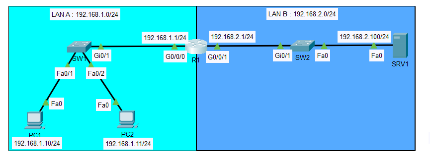

# Lab 02 — Ethernet, ARP, vie d'un paquet, TCP et UDP

**Domaines CCNA 200-301 :** Network Fundamentals
**Progression Jeremy's IT Lab :** Days 3, 5 à 8, 10, 12 et 30
**Outil :** Cisco Packet Tracer 8.2 · **Statut : en cours**

## Objectif

Observer couche par couche ce qui se passe quand un poste joint un autre poste, puis un serveur web appelé par son nom : apprentissage des adresses MAC, résolution ARP, décision de routage, résolution DNS sur UDP et session HTTP sur TCP.

## Topologie

```
   PC1  192.168.1.10                          SRV1  192.168.2.100
   PC2  192.168.1.11                          (DNS + HTTP)
      \                                              |
     [SW1] --Gi0/1-- G0/0/0 [ R1 ] G0/0/1 --Gi0/1-- [SW2]
            192.168.1.1              192.168.2.1

LAN A : 192.168.1.0/24               LAN B : 192.168.2.0/24
```



## Plan d'adressage

| Équipement | Interface | Adresse | Passerelle | DNS |
|---|---|---|---|---|
| R1 | G0/0/0 | 192.168.1.1/24 | — | — |
| R1 | G0/0/1 | 192.168.2.1/24 | — | — |
| PC1 | Fa0 | 192.168.1.10/24 | 192.168.1.1 | 192.168.2.100 |
| PC2 | Fa0 | 192.168.1.11/24 | 192.168.1.1 | 192.168.2.100 |
| SRV1 | Fa0 | 192.168.2.100/24 | 192.168.2.1 | — |

Sur SRV1 : service DNS avec l'enregistrement `www.lab.local` → 192.168.2.100, et service HTTP activé.

## Observations

### 1. Apprentissage des adresses MAC

Table MAC de SW1 relevée avec `show mac address-table` après un ping PC1 → PC2.

| Adresse MAC | Port | Comment SW1 l'a apprise |
|---|---|---|
| | | |

> À compléter.

### 2. Résolution ARP

Tables ARP relevées avec `arp -a` sur PC1 et `show ip arp` sur R1, avant puis après un ping vers SRV1.

| Équipement | Avant le ping | Après le ping |
|---|---|---|
| PC1 | | |
| R1 | | |

> À compléter.

### 3. Vie d'un paquet (mode Simulation, filtres ARP et ICMP)

| Saut | MAC source | MAC destination | IP source | IP destination | TTL |
|---|---|---|---|---|---|
| PC1 → R1 | | | | | |
| R1 → SRV1 | | | | | |

> À compléter. Ce qu'il faut démontrer : les adresses MAC changent à chaque saut, les adresses IP restent identiques de bout en bout, le TTL diminue de 1 à la traversée du routeur.

### 4. Résolution DNS sur UDP

| Champ | Valeur relevée |
|---|---|
| Protocole de transport | |
| Port destination | |
| Port source | |

> À compléter.

### 5. Session HTTP sur TCP

Poignée de main en trois temps relevée en mode Simulation.

| Étape | Drapeaux | Port source | Port destination |
|---|---|---|---|
| 1 | | | |
| 2 | | | |
| 3 | | | |

> À compléter.

## Panne à diagnostiquer

Serveur DNS de PC1 remplacé par 192.168.2.200. `www.lab.local` ne répond plus alors que `http://192.168.2.100` fonctionne.

| # | Commande | Résultat | Conclusion |
|---|---|---|---|
| | | | |

> À compléter avec `nslookup` et `ipconfig /all`.

## Ce que j'ai appris

> À compléter : 3 à 5 points.

## Questions de révision

<details>
<summary><b>1. Pourquoi l'adresse MAC change-t-elle à chaque saut, mais pas l'adresse IP ?</b></summary>

> À compléter.
</details>

<details>
<summary><b>2. Que fait un commutateur face à une trame dont il ne connaît pas l'adresse MAC de destination ?</b></summary>

> À compléter.
</details>

<details>
<summary><b>3. Dans quels cas préfère-t-on UDP à TCP ?</b></summary>

> À compléter.
</details>

<details>
<summary><b>4. Quel est le rôle du TTL ?</b></summary>

> À compléter.
</details>

## Fichiers

| Fichier | Contenu |
|---|---|
| `lab-02.pkt` | Maquette Packet Tracer |
| `configs/` | Configurations des équipements |
| `captures/` | Captures des observations |

---

FILS EMMANUEL RODRIGUE MINYEM · [github.com/FilsEmmanuel](https://github.com/FilsEmmanuel)
