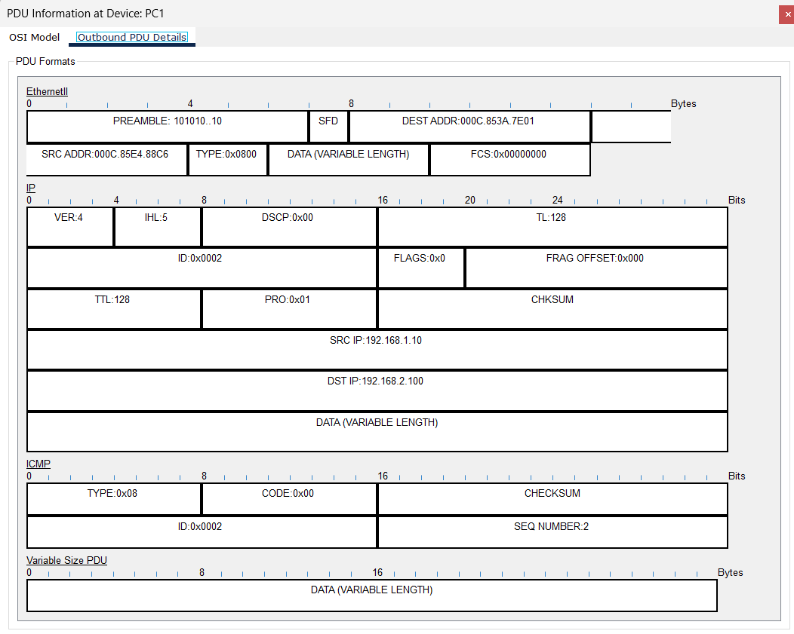
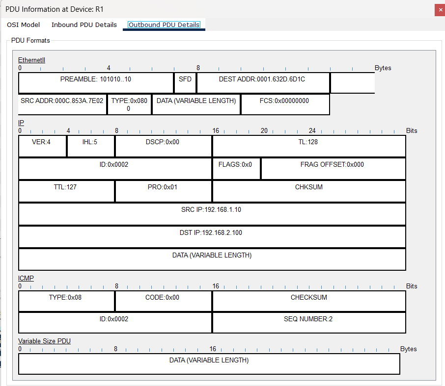
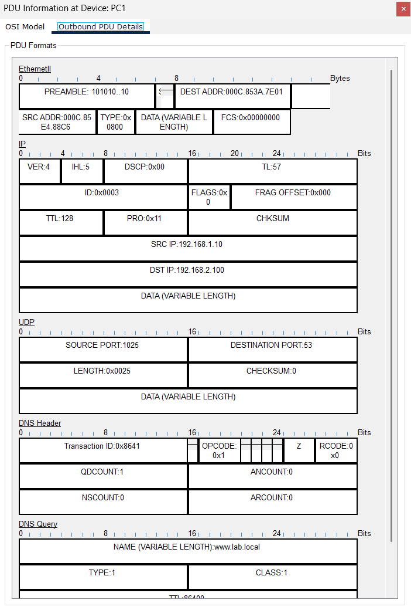
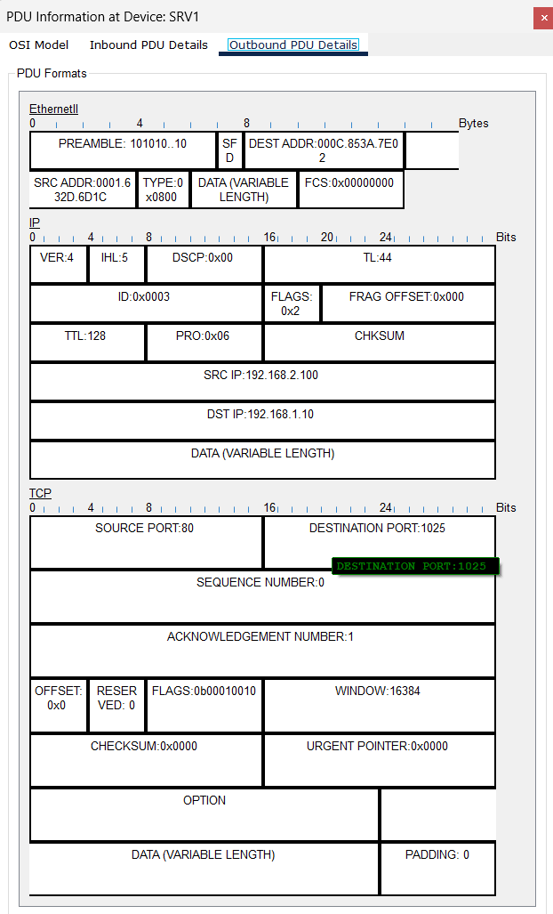
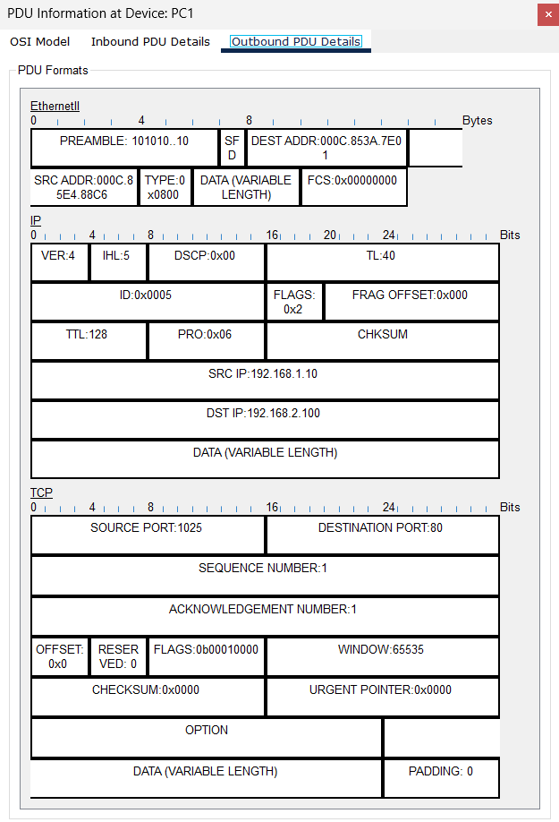
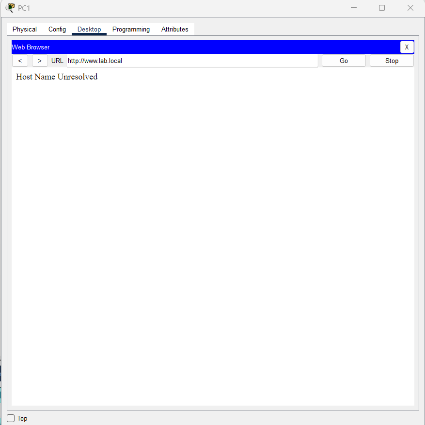
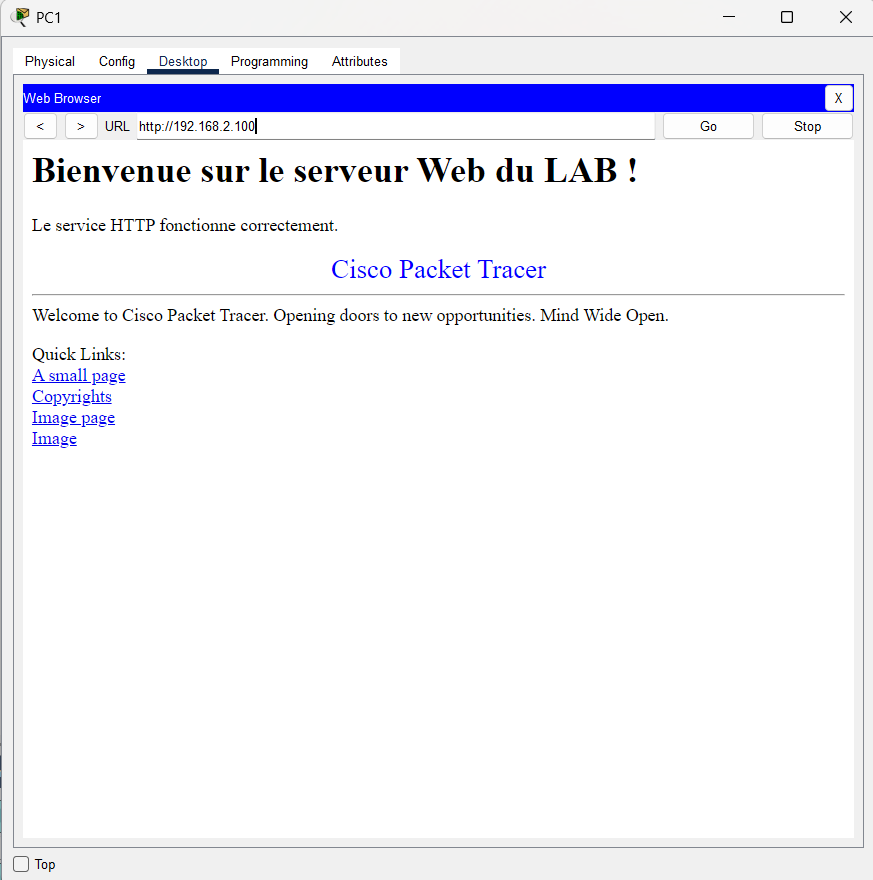
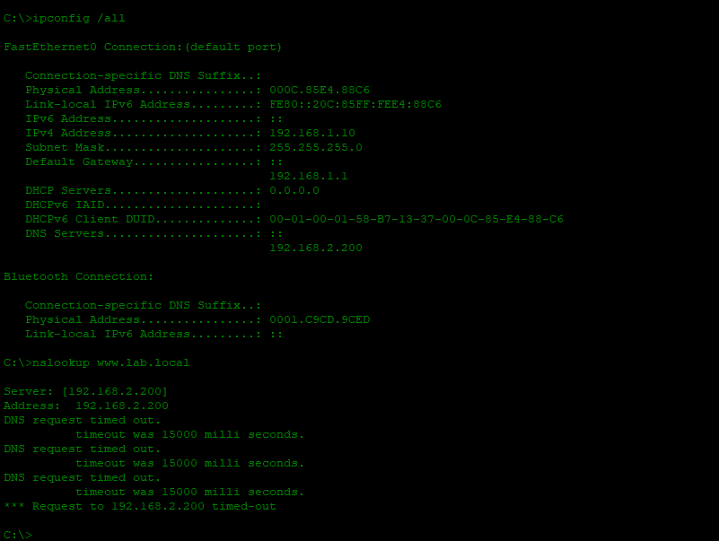

# Lab 02 — Ethernet, ARP, vie d'un packet, TCP et UDP

**Domaines CCNA 200-301 :** Network Fundamentals
**Progression Jeremy's IT Lab :** Days 3, 5 à 8, 10, 12 et 30
**Outil :** Cisco Packet Tracer 8.2 · **Statut : réalisé**

## Objectif

Observer couche par couche ce qui se passe quand un poste joint un autre poste, puis un serveur web appelé par son nom : apprentissage des MAC addresses, ARP resolution, décision de routage, DNS resolution sur UDP et session HTTP sur TCP.

## Topologie

```
   PC1  192.168.1.10                          SRV1  192.168.2.100
   PC2  192.168.1.11                          (DNS + HTTP)
      \                                              |
     [SW1] --Gi0/1-- G0/0/0 [ R1 ] G0/0/1 --Gi0/1-- [SW2]
            192.168.1.1              192.168.2.1

LAN A : 192.168.1.0/24               LAN B : 192.168.2.0/24
```


## Plan d'adressage

| Équipement | Interface | IP address | Gateway | DNS |
|---|---|---|---|---|
| R1 | G0/0/0 | 192.168.1.1/24 | — | — |
| R1 | G0/0/1 | 192.168.2.1/24 | — | — |
| PC1 | Fa0 | 192.168.1.10/24 | 192.168.1.1 | 192.168.2.100 |
| PC2 | Fa0 | 192.168.1.11/24 | 192.168.1.1 | 192.168.2.100 |
| SRV1 | Fa0 | 192.168.2.100/24 | 192.168.2.1 | — |

Sur SRV1 : service DNS avec l'enregistrement `www.lab.local` → 192.168.2.100, et service HTTP activé.

## Observations

### 1. MAC address learning

MAC address table de SW1, relevée avec `show mac address-table` après un ping PC1 → PC2.

| MAC address | Port | Équipement | Comment SW1 l'a apprise |
|---|---|---|---|
| `000c.85e4.88c6` | Fa0/1 | PC1 | Source MAC address de l'ARP request émis par PC1 |
| `00d0.58c4.348c` | Fa0/2 | PC2 | Source MAC address de l'ARP reply émis par PC2 |
| `000c.853a.7e01` | Gi0/1 | R1 (G0/0/0) | Source MAC address du trafic émis précédemment par R1 |

**Comment SW1 a construit sa MAC address table**

1. **PC1 cherche la MAC address de PC2.** Il connaît son IP address, mais il lui faut une MAC address pour construire la frame Ethernet. Il émet donc un **ARP request**, en broadcast (destination `ffff.ffff.ffff`) sur le LAN.

2. **SW1 apprend l'adresse de PC1.** À réception de cette frame, il lit la **source MAC address** et l'associe à l'ingress port : `000c.85e4.88c6` sur Fa0/1. La destination étant un broadcast, il applique le **flooding** et réémet la frame sur tous ses autres ports.

3. **PC2 répond.** Il reconnaît l'IP address recherchée comme la sienne et renvoie sa MAC address dans un **ARP reply**, en unicast cette fois. SW1 apprend `00d0.58c4.348c` sur Fa0/2.

4. **Les ICMP Echo Request circulent.** L'ARP resolution terminée, SW1 connaît les deux MAC addresses et commute directement vers le bon port, sans flooding.

La troisième entry, celle de R1, n'a pas été apprise pendant ce ping : elle provient du trafic émis par le router lors des tests précédents. Un switch n'apprend **jamais** depuis la destination MAC address, uniquement depuis la **source MAC address** des frames qu'il reçoit.

### 2. ARP resolution

Pour partir d'un état propre, les deux ARP caches ont été vidés : `arp -d` sur PC1, `clear arp-cache` sur R1. Un ping PC1 → SRV1 (192.168.2.100) a ensuite été lancé.

| Équipement | ARP cache vidé | Après le ping vers SRV1 |
|---|---|---|
| PC1 | `No ARP Entries Found` | **Une seule entry** : 192.168.1.1 → `000c.853a.7e01` (R1) |
| R1 | les 2 entries locales subsistent (Age `-`) | **4 entries** : les 2 locales, plus 192.168.1.10 (PC1) et 192.168.2.100 (SRV1), Age 0 |

```
C:\>arp -a
  Internet Address      Physical Address      Type
  192.168.1.1           000c.853a.7e01        dynamic
```

```
R1#show ip arp
Protocol  Address          Age (min)  Hardware Addr   Type   Interface
Internet  192.168.1.1             -   000C.853A.7E01  ARPA   GigabitEthernet0/0/0
Internet  192.168.1.10            0   000C.85E4.88C6  ARPA   GigabitEthernet0/0/0
Internet  192.168.2.1             -   000C.853A.7E02  ARPA   GigabitEthernet0/0/1
Internet  192.168.2.100           0   0001.632D.6D1C  ARPA   GigabitEthernet0/0/1
```

**Le point le plus instructif : PC1 n'a aucune entry pour 192.168.2.100.**

Avant d'émettre, PC1 compare la destination IP address (192.168.2.100) à la sienne (192.168.1.10) au travers de son subnet mask. La destination est hors de son subnet. Il ne cherche donc **pas** à résoudre la MAC address de SRV1 — il ne le pourrait pas, un ARP request est un broadcast et ne franchit jamais un router. Il résout à la place la MAC address de sa **default gateway**.

La frame qui quitte PC1 porte donc :

- **destination MAC** : `000c.853a.7e01`, c'est-à-dire R1 ;
- **destination IP** : 192.168.2.100, c'est-à-dire SRV1.

Deux équipements différents sur la même frame : c'est toute la dissociation entre layer 2 et layer 3, et c'est précisément ce que l'observation 3 va montrer champ par champ.

R1, lui, est directement connecté aux deux subnets : son ARP cache contient donc PC1 et SRV1.

**Règle générale : un ARP cache ne contient jamais que des IP addresses de subnets directement connectés.**

À noter également : l'entry de PC2 (192.168.1.11), présente lors de l'observation 1, a disparu. Le cache avait été vidé et PC2 n'a pas été contacté depuis.

### 3. Life of a packet (mode Simulation, filtre ICMP)

Ping PC1 → SRV1 (192.168.2.100), ARP déjà résolu. Valeurs relevées dans **Outbound PDU Details**, à PC1 puis à R1.

| Hop | Source MAC | Destination MAC | Source IP | Destination IP | TTL |
|---|---|---|---|---|---|
| PC1 → R1 | `000C.85E4.88C6` (PC1) | `000C.853A.7E01` (R1 G0/0/0) | 192.168.1.10 | 192.168.2.100 | **128** |
| R1 → SRV1 | `000C.853A.7E02` (R1 G0/0/1) | `0001.632D.6D1C` (SRV1) | 192.168.1.10 | 192.168.2.100 | **127** |




**Lecture du tableau**

- Les quatre MAC addresses diffèrent. R1 a entièrement réécrit l'en-tête Ethernet : il a défait la frame reçue sur G0/0/0 et en a construit une nouvelle sur G0/0/1, avec sa propre MAC address en source et celle de SRV1 en destination. Une MAC address n'a de portée que sur son propre segment.
- Les IP addresses sont rigoureusement identiques d'un hop à l'autre. Elles désignent les deux extrémités de la communication, de bout en bout, quel que soit le nombre de routers traversés.
- Le TTL passe de 128 à 127. Chaque router qui achemine un packet le décrémente de 1 ; arrivé à 0, le packet est détruit. C'est ce qui empêche un packet de tourner indéfiniment en cas de routing loop.

**Autres champs relevés**

| Champ | Valeur | Signification |
|---|---|---|
| Ethernet `TYPE` | `0x0800` | Le payload est un packet IPv4 |
| IP `PRO` | `0x01` | Le payload est un message ICMP |
| ICMP `TYPE` | `0x08` | Echo Request |

**La décision de PC1, détaillée par Packet Tracer**

L'onglet OSI Model de PC1 expose le raisonnement de l'émetteur :

```
3. The source IP address is not specified. The device sets it to the port's IP address.
4. The destination IP address 192.168.2.100 is not in the same subnet and is not the broadcast address.
5. The default gateway is set. The device sets the next-hop to default gateway.
```

Les étapes 4 et 5 confirment la conclusion de l'observation 2 : PC1 constate que la destination est hors de son subnet et désigne sa default gateway comme next hop. L'adressage layer 3 vise SRV1, l'adressage layer 2 vise R1.

**La réécriture de la frame chez R1**, lisible côte à côte dans l'onglet OSI Model :

| | In Layers (G0/0/0) | Out Layers (G0/0/1) |
|---|---|---|
| Layer 3 | 192.168.1.10 → 192.168.2.100 | 192.168.1.10 → 192.168.2.100 |
| Layer 2 | `000C.85E4.88C6` >> `000C.853A.7E01` | `000C.853A.7E02` >> `0001.632D.6D1C` |

Layer 3 inchangé, Layer 2 intégralement remplacé : c'est la définition même du routage.

### 4. DNS resolution over UDP

Ouverture de `http://www.lab.local` depuis le navigateur de PC1, en mode Simulation, filtre réglé sur DNS, TCP et HTTP. Avant le moindre octet de page, trois phases se succèdent dans l'Event List :

| Temps | Phase |
|---|---|
| 0.000 → 0.008 | **DNS** — query de PC1 vers SRV1, puis reply. 4 hops à l'aller, 4 au retour |
| 0.008 → 0.017 | **TCP** — trois packets, sans aucune donnée applicative |
| 0.016 → 0.028 | **HTTP** — la requête GET, puis la page |
| 0.028 → 0.030 | **TCP** — fermeture de la session |


**La query** (Outbound PDU Details à PC1, événement 0.000) :

| Champ | Valeur relevée |
|---|---|
| Transport protocol | **UDP** — champ IP `PRO:0x11`, soit 17 |
| Destination port | **53** |
| Source port | **1025** (ephemeral port) |
| DNS Transaction ID | `0x8641` |
| DNS Query | NAME `www.lab.local`, TYPE 1 (A record), CLASS 1 (IN) |
| QDCOUNT / ANCOUNT | 1 / 0 |

**La reply** (Inbound PDU Details à PC1, événement 0.008) :

| Champ | Valeur relevée |
|---|---|
| Source port | **53** |
| Destination port | **1025** |
| DNS Transaction ID | `0x8641` — identique à la query |
| QDCOUNT / ANCOUNT | 1 / **1** |
| DNS Answer | `www.lab.local` → **IP : 192.168.2.100**, TTL 86400 |



**Deux packets, et c'est tout.** Aucun handshake, aucun acknowledgement, aucune fermeture de session. La query part, la reply revient, la résolution est faite. Là où TCP consommera trois packets avant d'avoir transporté le moindre octet utile, UDP en dépense deux au total. C'est précisément ce qui le rend adapté au DNS : une question courte, une réponse courte, et si la reply se perd, le client réémet — moins coûteux que de maintenir une session pour deux échanges.

**Les ports s'inversent dans la reply.** 1025 → 53 à l'aller, 53 → 1025 au retour. Le well-known port 53 identifie le service sur SRV1 ; l'ephemeral port 1025, choisi par PC1, identifie le process qui attend la réponse. C'est ce couple qui permet à PC1 de remettre la reply au bon demandeur.

**Le Transaction ID remplace la session.** UDP ne conserve aucun état : rien, dans le transport, ne relie la reply à la query. Le DNS s'en charge lui-même en recopiant dans sa reply le Transaction ID `0x8641` émis par le client. Si deux résolutions étaient en cours simultanément, c'est ce champ — et non le transport — qui permettrait de les distinguer.

**Deux TTL à ne pas confondre.** Celui de l'en-tête IP (128, puis 127 après un hop) limite le nombre de routers qu'un packet peut traverser. Celui de la DNS Answer (86400, soit 24 heures) indique combien de temps PC1 peut garder le résultat dans son DNS cache avant de redemander. Même nom, deux couches, deux rôles sans rapport.

**Où se situe le DNS dans le modèle.** La structure du PDU répond seule à la question : `IP → UDP → DNS Header → DNS Query`. Le DNS Header est le payload d'UDP, exactement comme HTTP est le payload de TCP. Le DNS est donc un protocole de la couche application, qui se trouve utiliser UDP comme transport plutôt que TCP. Il bascule d'ailleurs sur TCP/53 lorsque la réponse dépasse 512 octets ou pour un zone transfer entre serveurs.

### 5. TCP three-way handshake et session HTTP

`www.lab.local` une fois résolu en 192.168.2.100, le navigateur ouvre une session TCP vers ce serveur. Trois packets passent avant le moindre octet de HTTP.

| Étape | Packet | Flags | Source port | Destination port | SEQ | ACK |
|---|---|---|---|---|---|---|
| 1 | PC1 → SRV1 | `0b00000010` — **SYN** | 1025 | 80 | 0 | — |
| 2 | SRV1 → PC1 | `0b00010010` — **SYN + ACK** | 80 | 1025 | 0 | 1 |
| 3 | PC1 → SRV1 | `0b00010000` — **ACK** | 1025 | 80 | 1 | 1 |




**Lecture des flags.** Packet Tracer affiche le champ FLAGS en binaire sur 8 bits, dans l'ordre `CWR ECE URG ACK PSH RST SYN FIN` :

```
0b00010010
    │   │
    │   └─── SYN = 1
    └─────── ACK = 1
```

L'étape 2 porte donc les deux flags dans un seul packet : SRV1 accuse réception du SYN de PC1 et émet le sien simultanément. C'est ce qui fait tenir l'établissement en trois packets et non en quatre.

**Le socket.** Les deux mêmes ports reviennent sur les trois packets : 1025 côté PC1, 80 côté SRV1. Le couple complet `192.168.1.10:1025 ↔ 192.168.2.100:80` identifie la session de bout en bout. Un second onglet du navigateur ouvrirait une seconde session, avec un autre ephemeral port, vers ce même port 80.

**Les numéros de séquence.** PC1 émet SEQ 0. SRV1 répond ACK 1, ce qui signifie « j'ai tout reçu jusqu'à l'octet 0, envoie-moi le suivant ». Le SYN consomme un numéro de séquence bien qu'il ne transporte aucune donnée : c'est pourquoi la réponse est ACK 1 et non ACK 0.

**Et seulement ensuite, HTTP.** La requête GET n'apparaît dans l'Event List qu'à 0.016, après le troisième packet TCP. Aucun octet applicatif ne circule tant que la session n'est pas établie des deux côtés.

**UDP et TCP, mesurés sur la même maquette**

| | DNS (UDP) | HTTP (TCP) |
|---|---|---|
| Champ IP `PRO` | `0x11` (17) | `0x06` (6) |
| Établissement de session | aucun | 3 packets |
| Port serveur | 53 | 80 |
| Accusé de réception | aucun | SEQ / ACK sur chaque packet |
| Appariement question/réponse | Transaction ID applicatif | assuré par le transport |
| Packets pour un échange | 2 | 3 avant la première donnée |

> **Notes de méthode.** L'étape 1 n'est pas relevée directement : elle se déduit de l'étape 2, dont l'`ACKNOWLEDGEMENT NUMBER:1` accuse réception d'un SYN de SEQ 0 émis du port 1025 vers le port 80.
>
> Packet Tracer réutilise l'ephemeral port 1025 pour la query DNS puis pour la session HTTP. Sur un système réel, le resolver et le navigateur sont deux process distincts et obtiennent deux ephemeral ports différents.

## Panne à diagnostiquer

**Panne introduite** : sur PC1, Desktop → IP Configuration, le DNS Server est remplacé par 192.168.2.200, une adresse à laquelle aucun équipement ne répond.

**Symptôme rapporté** : `http://www.lab.local` ne s'affiche plus. Le navigateur reste plusieurs dizaines de secondes sans rien afficher, puis retourne `Host Name Unresolved`.



### Démarche de diagnostic

| # | Commande | Résultat | Conclusion |
|---|---|---|---|
| 1 | `http://www.lab.local` | `Host Name Unresolved` | Le navigateur n'a jamais ouvert de session : il n'a pas obtenu d'IP address |
| 2 | `http://192.168.2.100` | La page est servie | Layers 1 à 4 opérationnels, service HTTP opérationnel. Seule la résolution de nom est en cause |
| 3 | `ping 192.168.2.100` | 4/4 replies, TTL=127 | Confirme le routage PC1 → SRV1 dans les deux sens |
| 4 | `ipconfig /all` | IPv4 192.168.1.10/24, Default Gateway 192.168.1.1, **DNS Servers 192.168.2.200** | Trois paramètres corrects, un quatrième suspect |
| 5 | `nslookup www.lab.local` | `Server: [192.168.2.200]` puis **`Request to 192.168.2.200 timed-out`** | Le serveur interrogé ne répond pas du tout |
| 6 | `ping 192.168.2.200` | 4 `Request timed out`, 100 % loss | Aucun équipement à cette adresse |





**Correction** : DNS Server remis à 192.168.2.100 sur PC1. `http://www.lab.local` est servi de nouveau.

### Raisonnement

**Le message d'erreur désigne déjà la couche.** Le navigateur n'annonce ni `connection refused` ni `connection timed out`, mais `Host Name Unresolved`. Il n'a pas échoué à joindre un serveur : il n'a jamais su lequel joindre. Le défaut est donc au-dessus du transport, dans la résolution de nom — avant même d'avoir lancé une commande.

**L'étape 2 est celle qui tranche.** Interroger le même serveur par son IP address court-circuite entièrement le DNS. La page s'affiche : le câblage, l'adressage, le routage, le three-way handshake et le service HTTP fonctionnent tous. En une manipulation, tout le reste de la chaîne est mis hors de cause et le périmètre de recherche se réduit à un seul mécanisme.

**Un timeout et un `Non-existent domain` ne mènent pas au même diagnostic.** C'est la distinction décisive de cette panne :

| Réponse de `nslookup` | Ce qu'elle signifie | Où chercher |
|---|---|---|
| `Non-existent domain` | Le serveur **a répondu** : il fonctionne, mais ne détient aucun record pour ce nom | Les records de la zone sur le serveur |
| `Request timed out` | **Aucune réponse** n'est revenue | Le serveur lui-même, ou le chemin jusqu'à lui |

Ici c'est un timeout. Le défaut n'est donc pas dans les records de la zone — que l'observation 4 avait pourtant vus répondre correctement — mais dans le serveur interrogé.

**L'étape 6 confirme, elle ne diagnostique pas.** Un ping sans réponse établit qu'aucun équipement ne répond à l'ICMP sur 192.168.2.200. Pris isolément il ne prouverait rien : un serveur DNS parfaitement fonctionnel peut filtrer l'ICMP tout en répondant sur UDP/53. C'est la convergence des étapes 5 et 6 — ni réponse DNS, ni réponse ICMP — qui permet de conclure que l'adresse est vide.

**Le délai avant l'erreur s'explique.** `nslookup` affiche trois tentatives à 15 000 ms, soit 45 secondes d'attente avant d'abandonner. C'est ce même mécanisme qui fait paraître le navigateur figé. Un utilisateur rapportera « le site ne charge pas » ou « le réseau est lent » là où le réseau fonctionne parfaitement : seul un serveur mal renseigné fait attendre un client dans le vide.

**Ce qu'`ipconfig /all` apporte en une commande.** IP address, subnet mask et default gateway conformes au plan d'adressage, DNS Server hors sujet. Trois paramètres innocentés et un désigné, en une seule sortie.

## Ce que j'ai appris

**Une frame peut viser deux équipements différents selon la couche.** Celle qui quitte PC1 porte en destination MAC address celle de R1, et en destination IP address celle de SRV1. Tant que je confondais les deux adressages, le routage restait abstrait ; les voir côte à côte dans un même PDU l'a rendu concret.

**Un ARP cache ne contient que des subnets directement connectés.** PC1 n'a jamais eu d'entry pour SRV1 et n'en aura jamais : un ARP request est un broadcast et ne franchit pas un router. Ce que PC1 résout, c'est la MAC address de sa default gateway, rien d'autre.

**Le TTL compte des hops, pas du temps.** Le nommage m'a induit en erreur jusqu'à ce que je le voie passer de 128 à 127 après un seul router. C'est un compteur anti-boucle, et c'est ce même mécanisme que `traceroute` détourne pour cartographier un chemin.

**La structure d'un PDU répond seule aux questions de couche.** Je me demandais où situer le DNS : `IP → UDP → DNS Header` l'a tranché sans qu'il soit besoin d'un cours. Le DNS Header est le payload d'UDP, exactement comme HTTP est celui de TCP — c'est donc un protocole applicatif, qui se trouve utiliser UDP.

**Tester par l'IP address coupe un diagnostic en deux.** Face à `Host Name Unresolved`, joindre le même serveur par son IP address met hors de cause toute la chaîne jusqu'à HTTP et réduit la recherche à un seul mécanisme. Et dans la réponse de `nslookup`, un timeout et un `Non-existent domain` ne désignent pas le même coupable : le premier accuse le serveur, le second ses records.

## Questions de révision

<details>
<summary><b>1. Pourquoi la MAC address change-t-elle à chaque hop, mais pas l'IP address ?</b></summary>

Parce qu'une MAC address n'a de portée que sur son propre segment : au-delà du router, elle est inutilisable. Chaque router doit donc défaire l'en-tête Ethernet reçu et en construire un nouveau, avec sa propre MAC address en source et celle du next hop en destination. ARP n'est pas la cause de ce changement, seulement le mécanisme qui permet au router de découvrir la MAC address de ce next hop.

Les IP addresses, elles, désignent les deux extrémités de la communication. Elles restent identiques de bout en bout, quel que soit le nombre de routers traversés : c'est ce qui permet à SRV1 de savoir à qui répondre.
</details>

<details>
<summary><b>2. Que fait un switch face à une frame dont il ne connaît pas la MAC address de destination ?</b></summary>

Il procède à un **unknown unicast flooding** : la frame est réémise sur toutes les interfaces du VLAN concerné, à l'exception de celle par laquelle elle est arrivée.

Dans le même temps, il apprend la **source MAC address** de cette frame et l'associe au port d'arrivée. Il ignore donc le destinataire mais enregistre l'expéditeur — c'est exactement ce que montre l'observation 1, où la MAC address de PC1 apparaît dans la table après l'émission de son ARP request.
</details>

<details>
<summary><b>3. Dans quels cas préfère-t-on UDP à TCP ?</b></summary>

**Quand la latence coûte plus cher que la perte.** En voix sur IP, en visioconférence ou en jeu en ligne, un échantillon retransmis arrive après le moment où il aurait dû être joué : il est bon à jeter. Mieux vaut une donnée perdue qu'une donnée en retard.

**Quand l'échange est trop court pour amortir un handshake.** Le DNS en est la démonstration, mesurée à l'observation 4 : deux packets au total, là où TCP en dépense trois avant d'avoir transporté le moindre octet utile. En cas de perte, réémettre la query revient moins cher qu'établir une session.

**Quand TCP est tout simplement impossible.** Un broadcast ou un multicast n'a pas d'interlocuteur unique avec qui ouvrir une session : TCP, par construction, ne peut pas les porter.
</details>

<details>
<summary><b>4. Quel est le rôle du TTL ?</b></summary>

Malgré son nom, le TTL ne mesure aucune durée : c'est un **compteur de hops**. Chaque router qui achemine le packet le décrémente de 1. Arrivé à 0, le packet est détruit et un message ICMP `Time Exceeded` repart vers la source.

Son rôle est d'empêcher qu'un packet circule indéfiniment en cas de routing loop. L'observation 3 le montre passer de 128 à 127 : un seul router traversé, un seul décrément.
</details>

## Fichiers

| Fichier | Contenu |
|---|---|
| `lab-02.pkt` | Maquette Packet Tracer |
| `configs/R1.txt` | Configuration de R1 |
| `captures/` | Captures des observations |

---

FILS EMMANUEL RODRIGUE MINYEM · [github.com/FilsEmmanuel](https://github.com/FilsEmmanuel)
